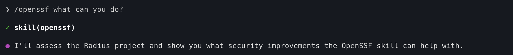
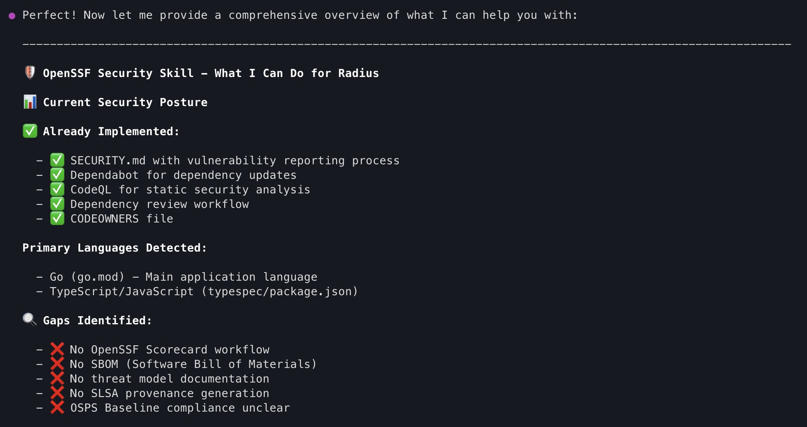
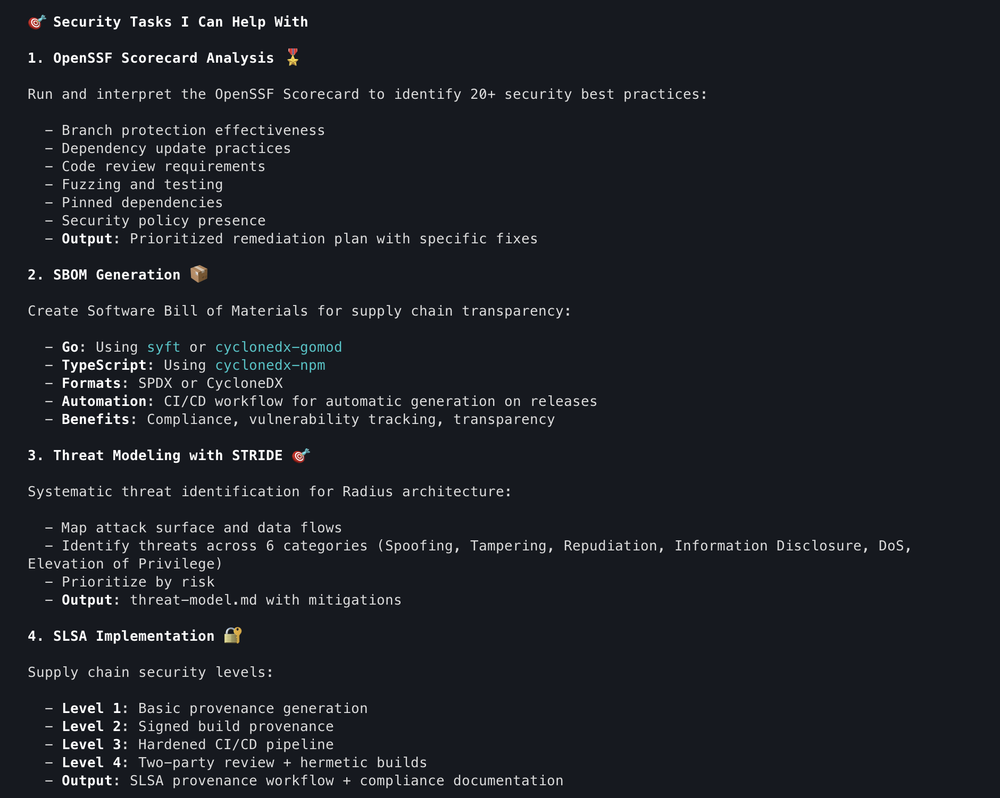
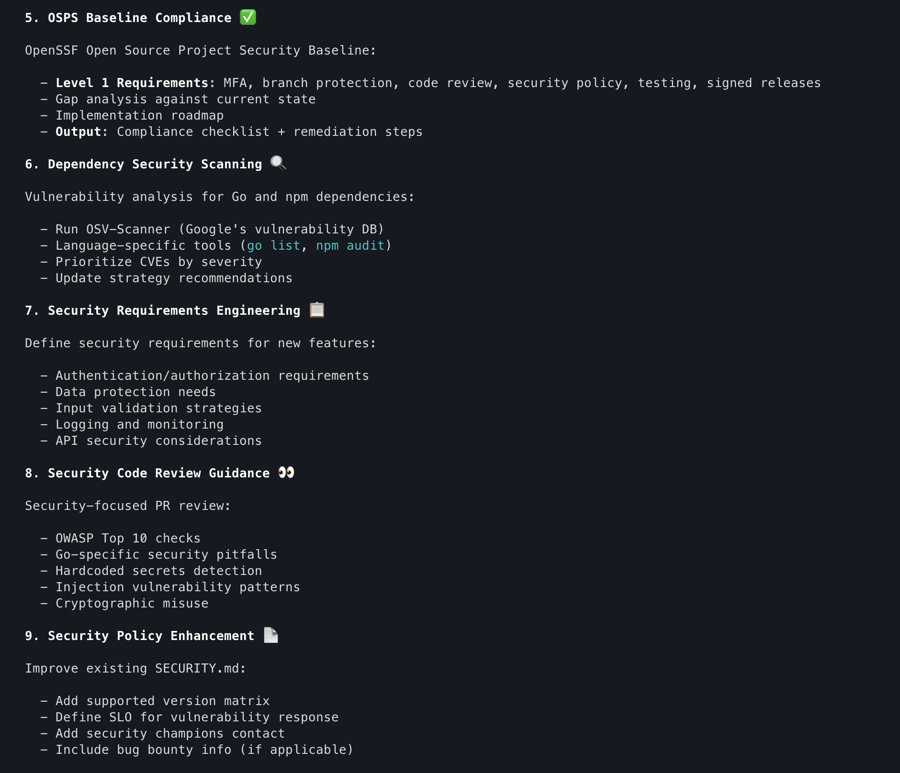
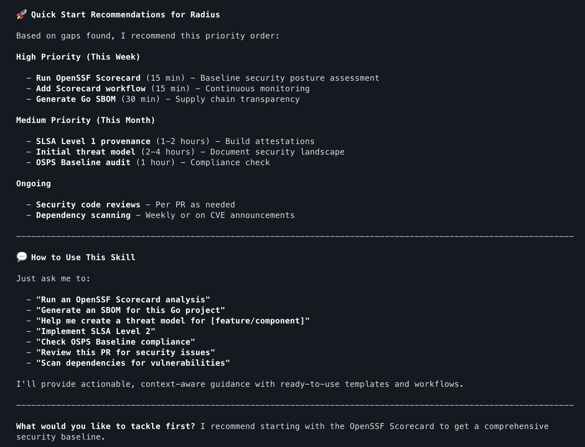
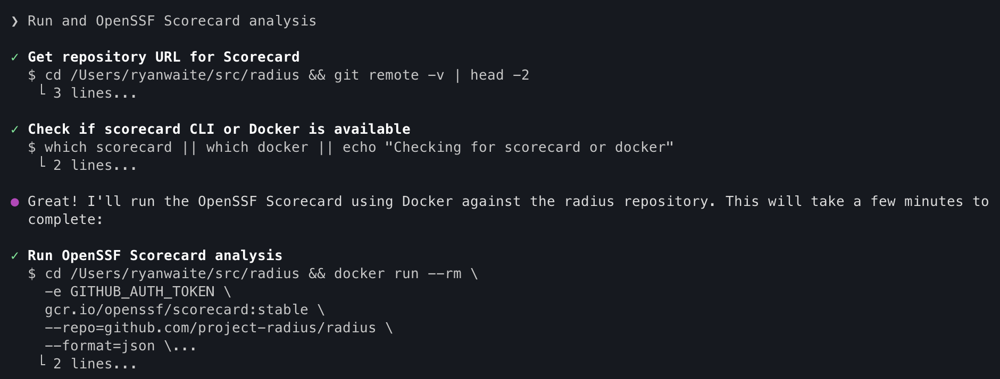
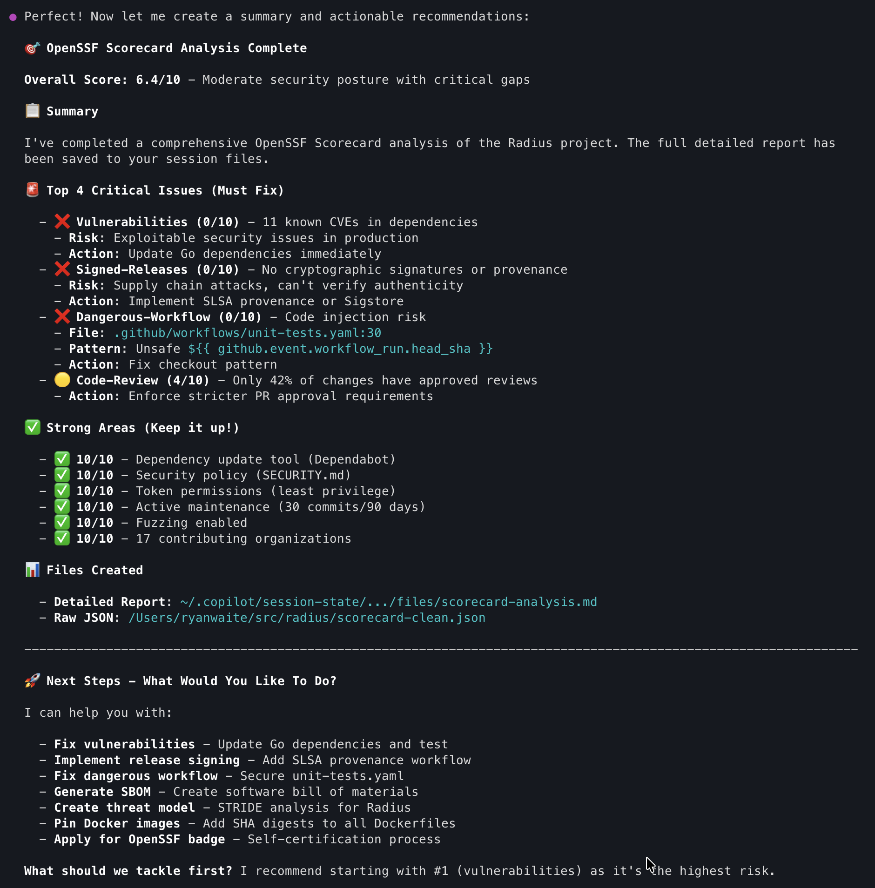

# OpenSSF Security Skill

A comprehensive Claude Code / GitHub Copilot skill that helps developers build
secure applications following [OpenSSF (Open Source Security Foundation)](https://openssf.org/)
best practices — and evaluate open source projects as an **ensemble**.

**Supports both GitHub Copilot and Claude Code.**

> **Two modes, one skill:**
> - **Advisor** — *help me build or fix a specific control.* Threat models,
>   SECURITY.md, SBOM setup, Sigstore signing, Dockerfile hardening, secrets
>   pre-commit hooks, Scorecard workflows. Assess → recommend → implement.
> - **Audit** — *tell me how safe this is.* Run the OpenSSF tools **together**
>   and fuse the signals into one decision-ready verdict:
>   - **Consume:** *Is this dependency safe to adopt?* → **Adopt / Adopt-with-mitigations / Avoid**
>   - **Produce:** *Is the project we build trustworthy and hardened?* → **A–F posture grade + roadmap**

---

## Why two modes?

Sometimes you know exactly what you need — "generate a SECURITY.md," "set up
SBOM generation," "harden this Dockerfile." That's **advisor** mode: it assesses
your project, recommends prioritized next steps, and walks you through building
the artifact using the bundled references, templates, and workflows.

Other times you just want a verdict. Most security tooling makes you run
Scorecard, then OSV-Scanner, then a secrets scan, then check signing… and then
*you* decide what it all means. **Audit** mode does the fusing for you:

```
        Scorecard ─┐
   OSV / audits ───┤
         SBOM ─────┤      normalize → weight by mode → escalate      ┌─ Adopt / Avoid   (consume)
   signing/SLSA ───┼──►   (live secrets & critical CVEs cap it)  ──► │
       secrets ────┤            ensemble/risk-model.md                └─ A–F grade       (produce)
   maintenance ────┤
  OSPS Baseline ───┘
```

The same tools run in both audit sub-modes — **the mode only changes the weights**.

---

## Installation

### For GitHub Copilot

Copy the Copilot instructions file to your repository:

```bash
# Create .github directory if it doesn't exist
mkdir -p .github

# Download the instructions file
curl -o .github/copilot-instructions.md \
  https://raw.githubusercontent.com/ryanwaite/openssf-skill/main/.github/copilot-instructions.md
```

Then enable custom instructions in VS Code:
1. Open Settings (`Cmd+,` or `Ctrl+,`)
2. Search for "Copilot instruction"
3. Enable `github.copilot.chat.codeGeneration.useInstructionFiles`

Copilot will now apply OpenSSF security best practices to all code suggestions in that repository.

### For Claude Code

#### Option 1: Clone to Global Skills (Recommended)

```bash
# Clone directly to your global skills directory
git clone https://github.com/ryanwaite/openssf-skill.git ~/.claude/skills/openssf
```

#### Option 2: Project-Specific Installation

```bash
# Clone into your project's .claude/skills directory
mkdir -p .claude/skills
git clone https://github.com/ryanwaite/openssf-skill.git .claude/skills/openssf
```

Then invoke the skill in any project with `/openssf`.

---

## Usage

The simplest way to get started:
1. Start GitHub Copilot or Claude Code
2. `cd` to the root of an open source project
3. Run `/openssf what can you do for me?`

The router sends your request to the right mode.

### Advisor mode — build or fix a specific control

```
/openssf help me create a threat model for my authentication system
/openssf generate a SECURITY.md for this project
/openssf what OpenSSF Scorecard checks am I failing?
/openssf set up SBOM generation for my releases
/openssf review this code for security issues
```

The skill will:
1. Assess your project's current security posture
2. Detect languages and existing security artifacts
3. Recommend prioritized security improvements
4. Guide you through creating security artifacts

### Audit mode — get a verdict or grade

```
/openssf evaluate this repo
/openssf is express@4.18.2 safe for us to adopt?
/openssf grade our security posture before release
```

The agent establishes the mode (consume vs produce), runs the ensemble, and
returns a verdict with evidence, ranked risks, and concrete next actions.

#### Run the ensemble directly

```bash
# Evaluate a dependency you might adopt
python3 scripts/ensemble-eval.py --target requests@2.31.0 --mode consume

# Grade a repo you own
python3 scripts/ensemble-eval.py --target . --mode produce --format md
```

Any tool that isn't installed is reported as `unknown` (and lowers confidence) —
never silently skipped.

---

## Example Walkthrough

This walkthrough demonstrates using the OpenSSF skill with GitHub Copilot to assess and improve the security posture of an open source repository.

### Step 1: Invoke the Skill

Start by invoking the OpenSSF skill in your project:



### What It Can Do

The skill looks at the project and provides an assessment of the overall project:



### Comprehensive List of Available Capabilities

The skill provides a comprehensive list of security features it can help with:




### Recommendation for Next Steps

The skill provides a prioritized list of what to do next along with the approximate time to complete each activity:



### Step 2: Run Scorecard

In this walkthrough we go with the recommendation to start with running Scorecard:



### Scorecard Results

The skill spins up a container, runs the Scorecard analysis, and provides the results:



From here, you can use the skill to keep implementing changes.

---

## How it works

| Layer | File(s) | Role |
|-------|---------|------|
| **Router** | `SKILL.md`, `.github/copilot-instructions.md` | Sends the request to advisor or audit |
| **Advisor** | `skills/advisor/` | Assess → recommend → implement a specific control |
| **Audit orchestrator** | `skills/audit/` | Establishes consume/produce mode, runs the battery, produces the report |
| **Audit modes** | `skills/audit/consume/`, `skills/audit/produce/` | Mode-specific batteries and outputs |
| **Fusion engine** | `ensemble/risk-model.md` | Normalization, mode weights, escalation rules, outcome mapping |
| **Output spec** | `ensemble/report-template.md` | The decision-ready report format |
| **Runner** | `scripts/ensemble-eval.py` | Executes the audit ensemble, emits fused JSON/Markdown (degrades gracefully) |
| **Detector** | `scripts/assess-project.py` | Local language/artifact detection |
| **Grounding** | `references/` | Deep per-tool guidance both modes draw on |

### The verdict, in short (audit mode)

- **Mode sets the weights.** Consume leans on known CVEs + maintenance; produce
  leans on secrets + provenance + code review.
- **Escalations override the average.** A live secret or an unpatched CRITICAL
  with a fix available caps the verdict no matter how good everything else looks.
- **Unknown ≠ fine.** Missing data lowers confidence; it never inflates the score.
- **Every claim cites a tool. Every verdict shows its math.** Two evaluators
  running the same tools on the same target reach the same verdict.

---

## Repository Structure

```
openssf-skill/
├── .github/
│   └── copilot-instructions.md   # GitHub Copilot instructions (router + secure-coding)
├── SKILL.md                      # Claude Code skill file — router: advisor | audit
├── skills/
│   ├── advisor/SKILL.md          # Build/fix a specific control (v1 guidance behavior)
│   └── audit/
│       ├── SKILL.md              # Ensemble orchestrator (establishes consume/produce)
│       ├── consume/SKILL.md      # Third-party OSS → Adopt / Adopt-with-mitigations / Avoid
│       └── produce/SKILL.md      # Projects you ship → A–F grade + roadmap
├── ensemble/
│   ├── risk-model.md             # Normalization, weights, escalation, outcome mapping
│   └── report-template.md        # Decision-ready report format
├── scripts/
│   ├── assess-project.py         # Project language/artifact detection
│   └── ensemble-eval.py          # Runs the audit ensemble, emits fused verdict
├── tests/
│   ├── test_assess_project.py    # Unit tests
│   └── test_ensemble_eval.py     # Fusion / risk-model tests
├── templates/
│   ├── SECURITY.md.template
│   ├── threat-model.md.template
│   └── vulnerability-disclosure-policy.md.template
├── workflows/
│   ├── scorecard.yml.template
│   ├── slsa-provenance.yml.template
│   ├── sbom-generation.yml.template
│   ├── dependency-review.yml.template
│   └── gitlab-ci-security.yml.template  # GitLab CI/CD
└── references/
    ├── threat-modeling/          # STRIDE methodology
    ├── scorecard/                # All 19 checks + remediation
    ├── osps-baseline/            # Compliance checklists
    ├── sbom/                     # Language-specific tools
    ├── slsa/                     # Supply chain security
    ├── dependency-security/      # Vulnerability scanning
    ├── security-policies/        # Policy creation guides
    ├── security-requirements/    # Requirements checklist
    ├── code-review/              # Security review guide
    ├── secrets-scanning/         # Secret leak prevention
    ├── signing/                  # Sigstore/Cosign guide
    ├── container-security/       # Docker hardening
    └── best-practices-badge/     # OpenSSF Badge guide
```

---

## Security Topics Covered

| Topic | Description |
|-------|-------------|
| Threat Modeling | STRIDE methodology, DFD creation, risk assessment |
| Security Policies | SECURITY.md, vulnerability disclosure, response timelines |
| OpenSSF Scorecard | 19 automated security checks with remediation |
| OSPS Baseline | Level 1 compliance checklist |
| SBOM | SPDX generation (default) for all major languages |
| SLSA | Supply chain security levels 0-3 |
| Dependencies | Vulnerability scanning, update strategies |
| Code Review | OWASP Top 10, language-specific patterns |
| Secrets Scanning | Gitleaks, TruffleHog, detect-secrets, pre-commit hooks |
| Artifact Signing | Sigstore ecosystem: Cosign, Fulcio, Rekor, Gitsign |
| Container Security | Dockerfile hardening, image scanning, distroless bases |
| Best Practices Badge | OpenSSF Badge self-certification (Passing/Silver/Gold) |

---

## Requirements

| Tool | Required For |
|------|--------------|
| [GitHub Copilot](https://github.com/features/copilot) | Copilot instructions |
| [Claude Code](https://claude.com/product/claude-code) | Claude Code skill |
| Git | Cloning the repository |
| Python 3 | Running `scripts/` and the ensemble runner |

---

## Contributing

Contributions are welcome! See [CONTRIBUTING.md](CONTRIBUTING.md) for detailed guidelines, content standards, and testing instructions.

Quick start:
1. Fork the repository
2. Create a feature branch
3. Make your changes (run `python3 -m unittest discover tests/ -v` to validate)
4. Submit a pull request

---

## License

MIT License - see [LICENSE](LICENSE) for details.

---

## References

- [OpenSSF Best Practices](https://best.openssf.org/)
- [OpenSSF Scorecard](https://scorecard.dev/)
- [SLSA Framework](https://slsa.dev/)
- [OSPS Baseline](https://baseline.openssf.org/)
- [OWASP Top 10](https://owasp.org/www-project-top-ten/)
- [GitHub Copilot Custom Instructions](https://docs.github.com/copilot/customizing-copilot/adding-custom-instructions-for-github-copilot)

---

## Acknowledgments

Built following OpenSSF guidelines and recommendations for secure software development.
